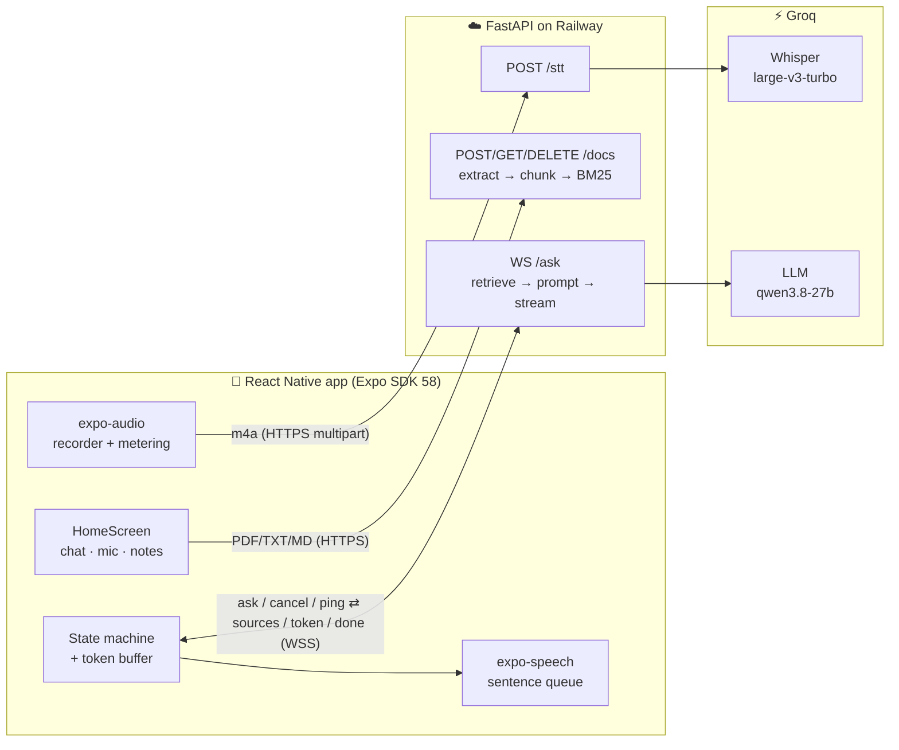

# VoiceNotes

**A hands-free voice study companion: upload your notes, ask out loud, and hear a streamed answer that cites the exact page, and interrupt it any time.**

| | |
|---|---|
| 📱 **Android APK** | [VoiceNotes-v1.0.0.apk](https://github.com/aadhi590/voicenotes/releases/download/v1.0.0/VoiceNotes-v1.0.0.apk) · [release page](https://github.com/aadhi590/voicenotes/releases/tag/v1.0.0) |
| ☁️ **Backend** | https://api-production-90b19b2d.up.railway.app ([`/health`](https://api-production-90b19b2d.up.railway.app/health)) |
| 🎬 **Demo video** | _coming soon_ |

---

## Features

- **Tap-to-talk with auto-stop on silence.** Tap the mic, speak, and recording ends by itself after ~1.2 s of silence (30 s cap).
- **Speech-to-text** with Groq Whisper (`whisper-large-v3-turbo`).
- **RAG over your own notes.** PDF/TXT/MD are chunked per page, retrieved with BM25, and answered with inline **`[n]` citations tied to the source page**. Tap a citation to see the snippet.
- **Token streaming over a WebSocket.** The answer appears as it's generated.
- **Sentence-by-sentence text-to-speech.** Each sentence is spoken as soon as it's complete, with citation markers stripped.
- **Barge-in.** Tap the mic (or send a new question) mid-answer: speech stops instantly, the in-flight answer is cancelled, and it starts listening.
- Notes panel (upload / list / delete / clear), auto-speak toggle, live connection indicator.

## Architecture



Every request carries a per-install `device_id`, so each phone has its own note store. One long-lived WebSocket carries many questions. Each question has a client-generated id, which is what makes cancel and barge-in clean.

## Mobile engineering highlights

- **Pure state machine with stale-id dropping** (`src/state/machine.ts`): `idle → recording → transcribing → thinking → streaming → idle`, plus a `speaking` flag. Every server event carries a question id, and any event whose id isn't the active one is dropped. A late token, a `done` or an error from a cancelled or barged-in answer can never change the UI. 18 reducer tests cover this.
- **50 ms token buffer, ≤ 20 renders/s** (`src/hooks/useTokenBuffer.ts`): tokens are appended to a plain string outside React and published at most every 50 ms through `useSyncExternalStore`, with a leading-edge flush so the first token isn't delayed. A test streams 200 tokens in 1 s and asserts ≤ 21 updates with exact final text.
- **Only the live bubble re-renders.** Finished messages are memoized `FlatList` rows. The streaming answer is the `ListFooterComponent`, so token flushes never touch list data. Citations are parsed once, on the final text.
- **Waveform on the UI thread:** 24 bars driven by Reanimated shared values, fed from recorder metering every 50 ms (dB normalised from -60..0 to 0..1, lightly smoothed). Metering never re-renders React.
- **Resilient WebSocket** (`src/api/wsClient.ts`): exponential backoff (0.5 → 8 s) with jitter, a 25 s ping with a 10 s pong timeout (proxies drop idle sockets silently), asks queued while offline with an 8 s "Can't reach server" timeout, and "Connection lost, tap retry" for answers in flight. 13 tests run against a fake socket.
- **Silence guard against Whisper hallucinations:** Whisper turns silence into "Thank you." Recordings that never crossed the speech threshold, or are shorter than 0.4 s, are discarded without calling `/stt`. Known filler transcripts are dropped when the audio was quiet. The rule is a pure, tested function.
- **TTS tied to the question id:** the sentence queue only accepts text for the active id, and a generation counter ignores callbacks from stopped utterances. After barge-in, no late sentence from the old answer is ever spoken.
- **AppState handling:** recording stops (and is discarded) when the app is backgrounded. The socket reconnects immediately when the app returns to the foreground.

## Measured latency

Warm requests, p50 / p95, from the end-to-end suite (`backend/scripts/e2e/run_all.py`, real Groq):

| Stage | p50 | p95 |
|---|---|---|
| STT (`/stt`, ~3 s question, server-side) | 255 ms | 332 ms |
| Retrieval (BM25) | 1 ms | 1 ms |
| Time to first token | 229 ms | 478 ms |
| Total answer (text) | 367 ms | 554 ms |

Against the deployed Railway instance (US East, measured from India), quick runs showed TTFT of 171–360 ms. The network round trip was ~285 ms.

## Why Expo

- **Managed native modules:** audio recording, TTS, file system and Reanimated all come as SDK-versioned packages that work together, and they run in Expo Go for fast iteration on a real phone.
- **EAS Build:** a signed Android APK from the cloud with one command (`eas build -p android --profile preview`). No local Android Studio or keystore handling.
- **Room to grow:** `npx expo prebuild` generates the native `android/` and `ios/` projects whenever custom native code is needed. The app stays a standard React Native project.

## Run locally

### Backend (Python 3.11)
```bash
cd backend
python -m venv .venv && .venv\Scripts\activate      # macOS/Linux: source .venv/bin/activate
pip install -r requirements-dev.txt
echo GROQ_API_KEY=your_key_here > .env
uvicorn main:app --port 8000
```

### Mobile (Node 22+)
```bash
cd mobile
npm install
echo EXPO_PUBLIC_API_URL=http://<your-LAN-IP>:8000 > .env   # or the Railway URL
npx expo start          # open in Expo Go; add --tunnel if the phone can't reach your LAN
```

### Environment variables
| Where | Name | Notes |
|---|---|---|
| backend | `GROQ_API_KEY` | Required for `/stt` and `/ask`. Without it the server still starts and `/health` reports `groq_configured: false`. |
| backend | `PORT` | Set by Railway. Locally the server runs on 8000. |
| mobile | `EXPO_PUBLIC_API_URL` | Backend base URL. The WebSocket URL (`wss://…/ask`) is derived from it. Missing → red banner, no crash. |

### Tests
| Suite | Command | Count |
|---|---|---|
| Backend unit/API/WebSocket (Groq mocked) | `cd backend && pytest` | **38** |
| Mobile (state machine, citations, token buffer, socket, upload, voice) | `cd mobile && npx jest` | **66** |
| End-to-end against a live server + real Groq | `cd backend && python scripts/e2e/run_all.py --base <url>` | **94** checks (`--quick`: 9) |

CI (GitHub Actions) runs pytest and the mobile typecheck + jest on every push. Deployment details are in [DEPLOYMENT.md](DEPLOYMENT.md).

## Known limitations

- **In-memory storage.** Uploaded notes live in server memory and are lost on every redeploy or restart, so you have to re-upload. This is also why the service runs a single replica.
- **Groq free-tier rate limit:** 8,000 tokens/min, roughly **5–6 answers per minute** across all users (~1,400 tokens per answer). Beyond that the app shows "Busy, retry in a few seconds".
- **Android only.** It's built and tested on Android. The code is cross-platform, but iOS hasn't been built or tested.
- **No scanned PDFs.** Only PDFs with a text layer are supported; image-only pages are rejected with a clear message (no OCR).
- **No background or lock-screen audio.** Recording stops when the app leaves the foreground, and speech is foreground-only.
- **No auth.** A per-install device id separates data, but anyone with the backend URL can use it. Fine for a demo; add auth before a wider launch.
- On Android, uploaded files appear as `notes-HHmm.pdf`, because the system picker doesn't expose the original display name.
